[hello-rust](https://github.com/Vellinhellin/hello-rust)
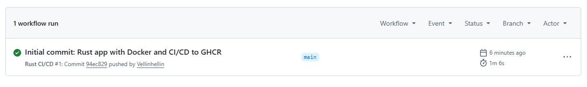
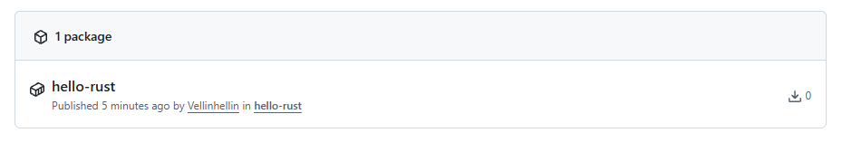
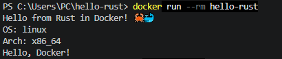
---

[hello-go1](https://github.com/Vellinhellin/hello-go)
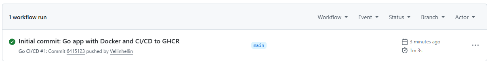
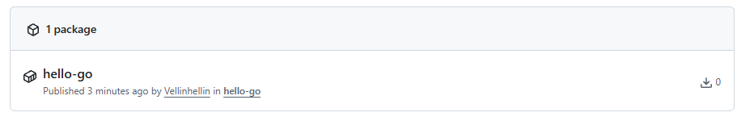
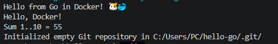
---

[hello-go2](https://github.com/Vellinhellin/hello-go)
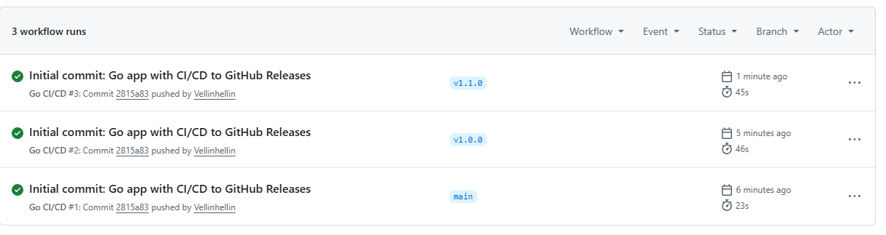
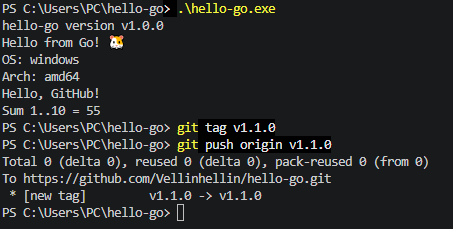\
---

[hello-python](https://github.com/Vellinhellin/hello-python)
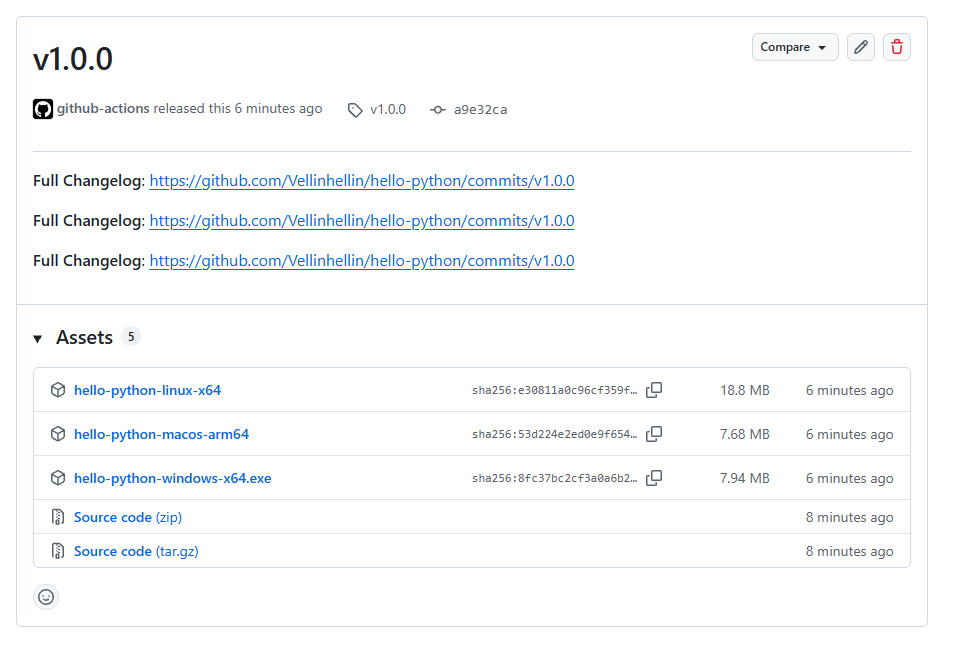
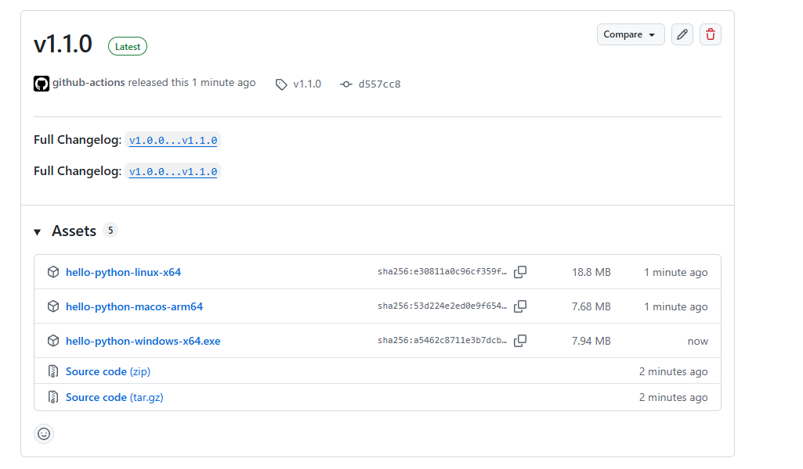
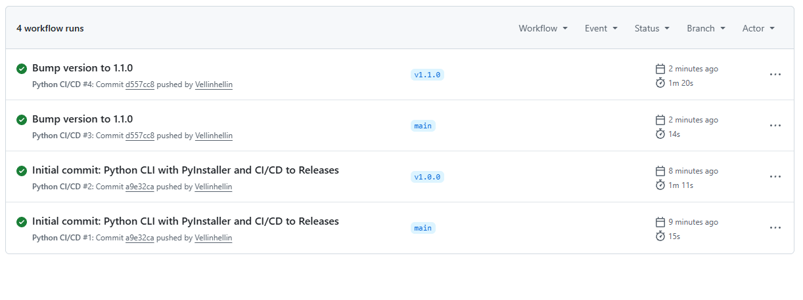
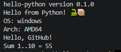
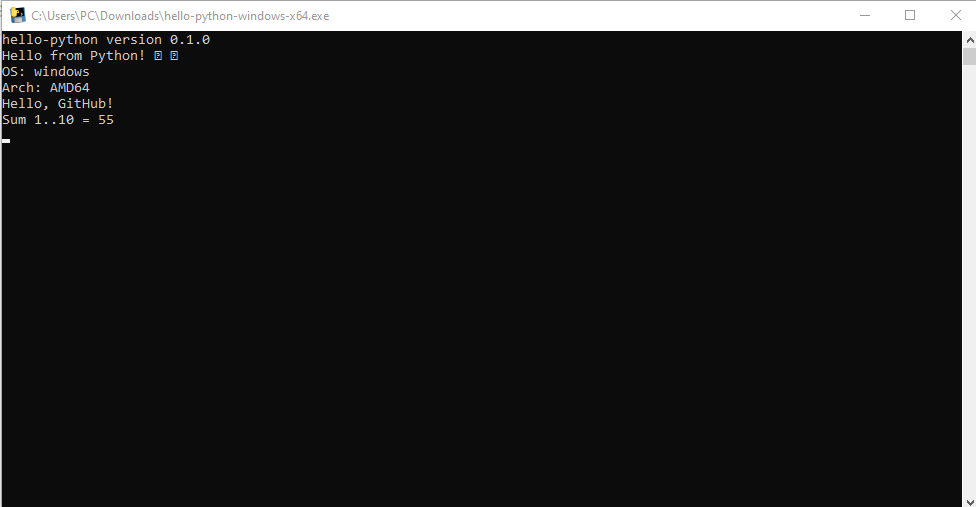
---

[hello-dotnet](https://github.com/Vellinhellin/hello-dotnet)
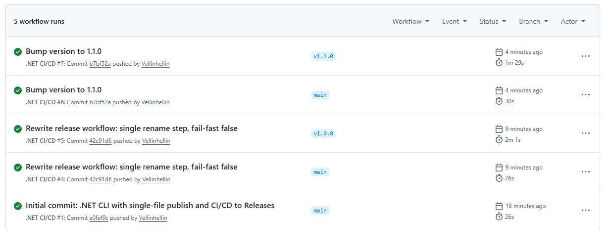
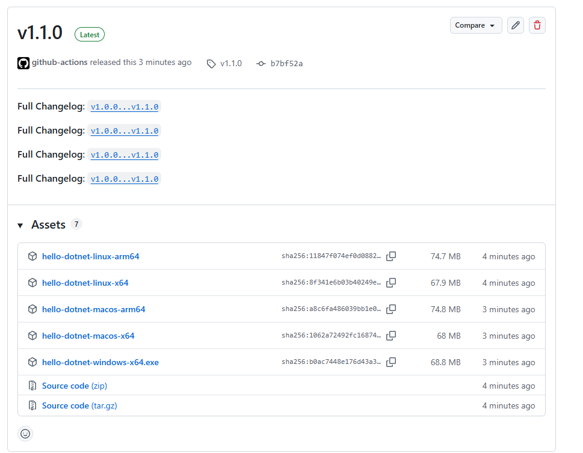
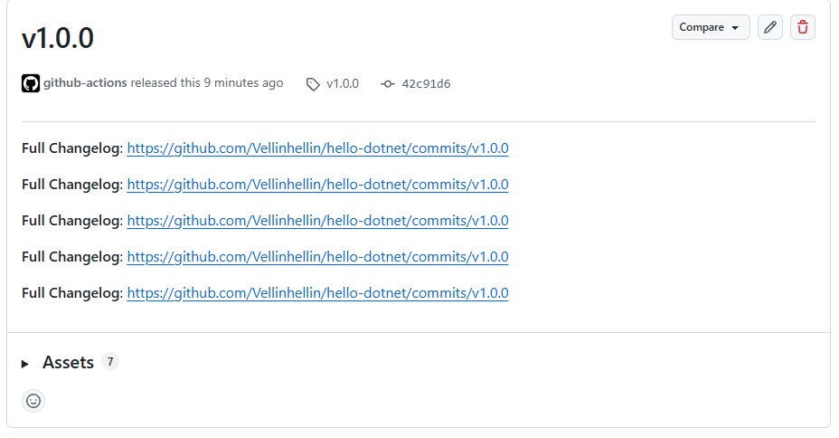
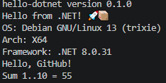
---

[CD_Go_GUI](https://github.com/Vellinhellin/hello-gui)
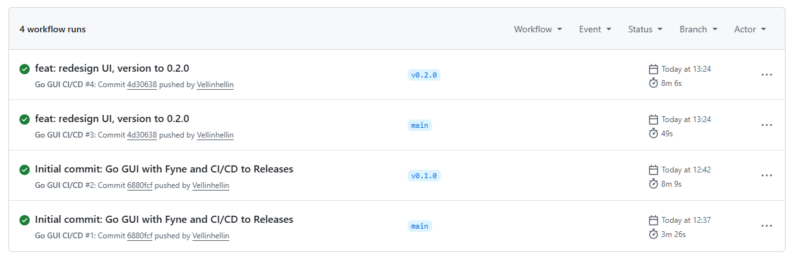
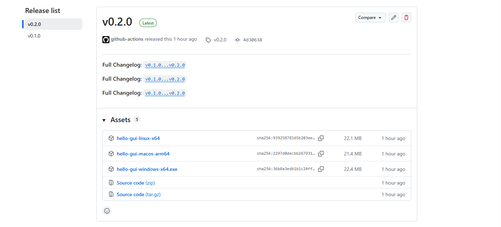
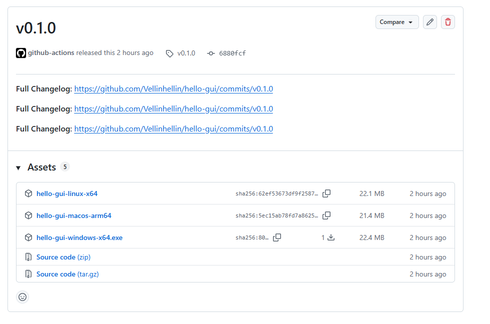
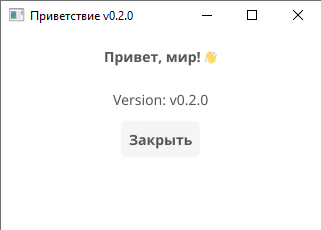
---

[HexLoader](https://github.com/Vellinhellin/hex-loader)
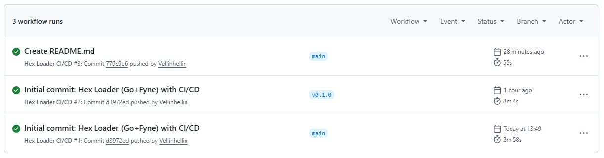
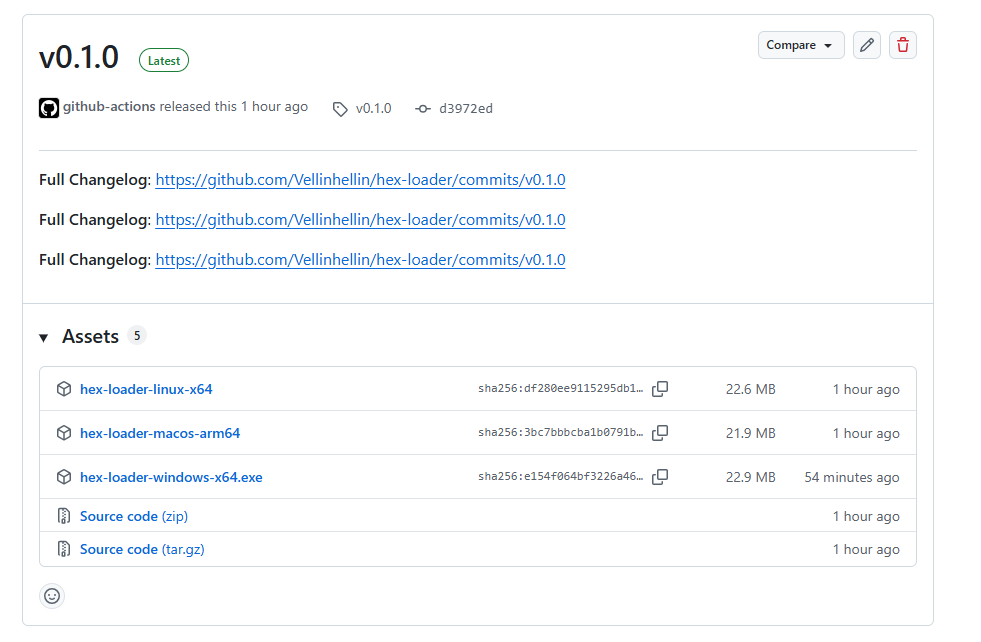
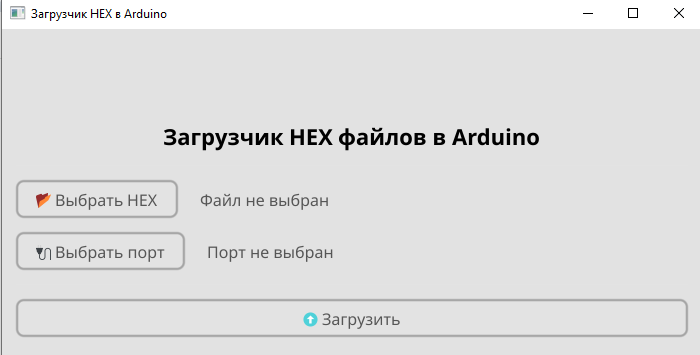
---

[ArduinoManager](https://github.com/Vellinhellin/arduino-manager)
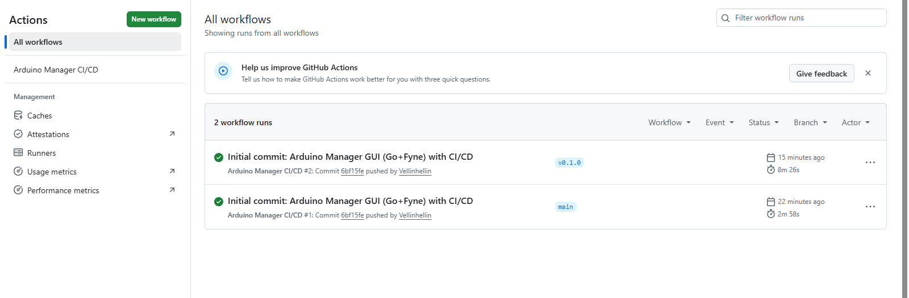
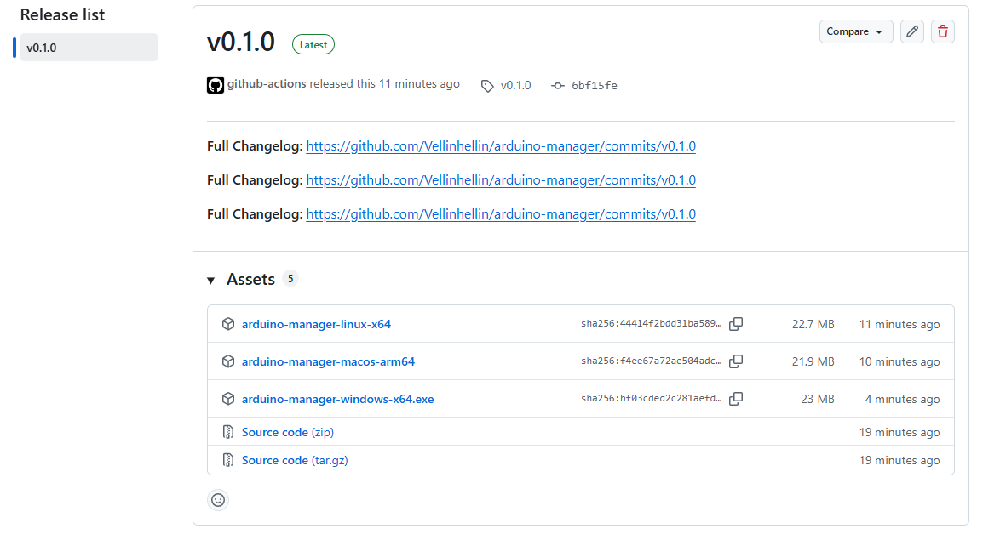
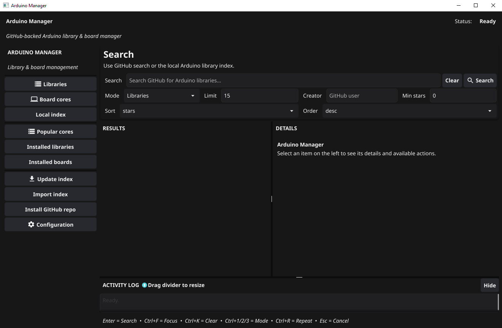
---